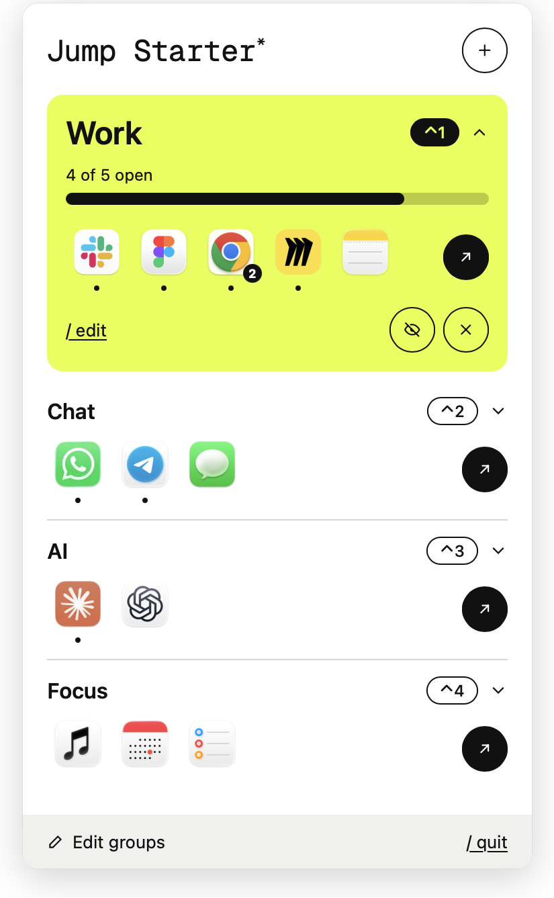
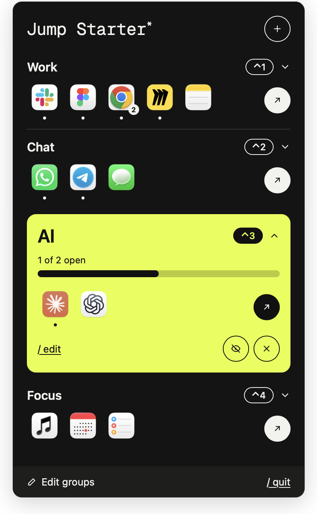
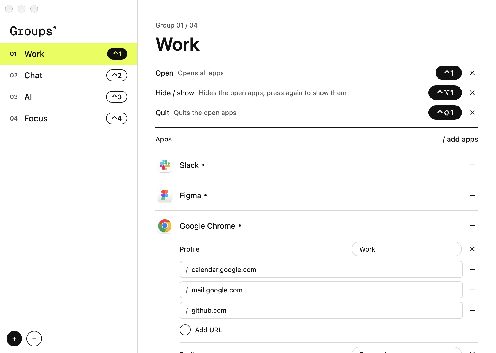

  

<h1 align="center">Jump Starter</h1>

  <b>Start your whole workspace with one shortcut.</b> 
  Group the apps you use together, then open, hide or quit them all at once, 
  from the menu bar or system tray. For Windows, Linux and macOS.

  <a href="../../releases/latest"><b>Download the latest version</b></a>

  
  &nbsp;&nbsp;
  

---

## What it does

You probably open the same set of apps for the same kind of work: Slack, Figma and a few browser tabs for work;
WhatsApp and Telegram for chatting; your music app and calendar for focus time. Jump Starter turns each of those
sets into a **group**:

- **Open a group** with one shortcut (e.g. **Ctrl+1**). Apps that aren't running start; apps that are running
  come to the front.
- **Hide / show a group** with another (e.g. **Ctrl+Alt+1**) to clear your screen, and press it again to bring
  everything back.
- **Quit a group** (e.g. **Ctrl+Shift+1**) when you're done. Apps close politely, so they can still ask you to save.
- **See what's running** at a glance: a dot under each app icon, and an "x of y open" bar per group.
- **Open the right browser profile with the right tabs.** Add Chrome, Edge, Brave, Vivaldi or Firefox to a group,
  pick a profile and list URLs: e.g. calendar and mail in your *Work* profile, the news in *Personal*. Several
  profiles per browser, each with its own URLs.

Everything stays on your computer: no account, no cloud, no tracking.

## The panel

Click the clamp icon in the menu bar / system tray:

- Every group with its apps and shortcut. Click a group to expand it, showing how many apps are open and buttons
  to **open**, **hide** or **quit** them all.
- Click an app icon to open just that app.
- **Edit groups** opens the editor. Esc or a click elsewhere closes the panel.
- Follows your system's **light or dark mode**.

## The editor

  

- Create, rename, reorder (drag) and delete groups.
- Click a shortcut to record a new one, or clear it. Conflicts with other apps are flagged.
- Add apps: on Windows pick programs or Start menu shortcuts, on Linux pick apps from
  `/usr/share/applications`, on macOS pick from Applications.
- For browsers: choose a profile and the URLs to open in it, and add more profiles as needed.

## Default shortcuts

New groups get these shortcuts (you can change or remove any of them):

| | Windows & macOS | Linux |
|---|---|---|
| Open group *N* | Ctrl+*N* (⌃*N*) | Ctrl+Alt+*N* |
| Hide / show group *N* | Ctrl+Alt+*N* (⌃⌥*N*) | Ctrl+Alt+Shift+*N* |
| Quit group *N* | Ctrl+Shift+*N* (⌃⇧*N*) | — |

## Install

Download the file for your system from the [latest release](../../releases/latest):

| System | File | How to install |
|---|---|---|
| **Windows 10/11** | `…_x64-setup.exe` | Run it. If Windows says *"Windows protected your PC"*, click **More info → Run anyway** (the app isn't code-signed yet). |
| **Ubuntu / Debian** | `…_amd64.deb` (ARM: `…_arm64.deb`) | `sudo apt install ./Jump.Starter_*.deb` |
| **Fedora** | `…x86_64.rpm` (ARM: `…aarch64.rpm`) | `sudo dnf install ./Jump.Starter-*.rpm` |
| **Any Linux** | `…AppImage` | `chmod +x` the file, then open it |
| **macOS (Apple silicon)** | `…_aarch64.dmg` | Drag to Applications; the first time, allow it in **System Settings → Privacy & Security → Open Anyway**. |

**Linux tray icon on GNOME (e.g. Ubuntu):** install the *AppIndicator* extension
(`sudo apt install gnome-shell-extension-appindicator`, then log out and in), otherwise GNOME hides tray icons.

## Good to know

- **Hide / show on Linux** works on X11 sessions (and for X11 apps under XWayland). Pure Wayland doesn't allow
  one app to control another app's windows, so there it does nothing; open and quit still work.
- **Windows "hide"** minimizes the group's windows (Windows has no "hide app" like macOS).
- **Microsoft Store apps** (e.g. the Store version of WhatsApp) can't be added yet, because they have no regular
  program file.
- **Safari, Arc and Opera** can open URLs but not specific profiles.

---

Built with [Tauri](https://tauri.app). For development notes see [DEVELOPMENT.md](DEVELOPMENT.md); for testing on
Windows/Linux virtual machines see [TESTING.md](TESTING.md).
